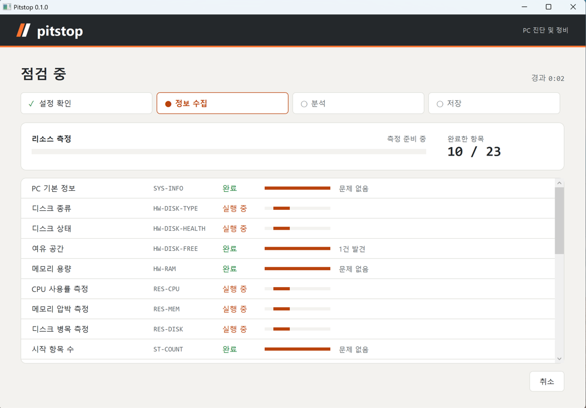
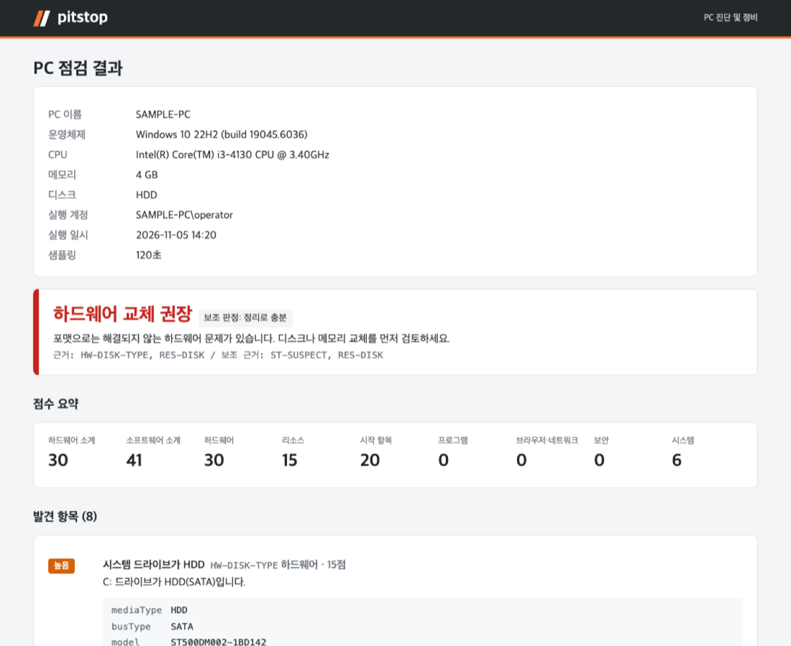

<a id="readme-top"></a>

<div align="center">
  

  <h1>PC Check</h1>

  <p>Before you reformat a slow Windows PC, find out whether a cleanup is enough</p>

  <p><a href="README.md">한국어</a> | <b>English</b></p>

  <p>
    <a href="https://github.com/Bigide19/pc-check/releases/latest/download/pccheck-win-x64.zip"></a>
    <a href="https://github.com/Bigide19/pc-check/releases/latest/download/PcCheck.exe"></a>
  </p>

  <p>
    
    
    
  </p>
</div>

<details>
<summary>Contents</summary>

- [About](#about)
- [Features](#features)
- [Download and run](#download-and-run)
- [Usage](#usage)
- [How the verdict works](#how-the-verdict-works)
- [Cautions](#cautions)
- [Build it yourself](#build-it-yourself)
- [Project layout](#project-layout)

</details>

## About



When a PC slows down, reformatting is usually the first idea. But if the cause is an HDD or too little memory, the PC will be slow again soon after the reformat. If the cause is a few startup programs, a reformat is more than you need. PC Check looks at hardware, resource usage, startup items, browser tampering, and security status in one pass, and gives one of three verdicts: "cleanup is enough", "reformat recommended", or "replace hardware".

It is a single exe that runs without installation, so you can copy it over USB or a remote session and run it right away. Scanning is read-only. Anything that changes the system runs only after you approve each item.

<p align="right">(<a href="#readme-top">back to top</a>)</p>

## Features

- **26 checks**: disk type and health, free space, memory size, CPU, memory, and disk load (measured for 120 seconds by default), graphics driver, startup items, services, scheduled tasks, known unwanted programs, the Photos app, programs that crash other apps, Korean banking and government security plugins, browser policies and extensions, hosts, proxy, antivirus status, threat history, updates, and system logs.
- **Find the program behind crashes**: when an app keeps crashing, PC Check finds the injected module in the error log and tells you which program it belongs to. It can open that program's uninstaller for you.
- **Security plugin cleanup**: Korean banking and government sites make visitors install security plugins. PC Check finds them, shows their published vulnerabilities, and lets you remove them in one go.
- **Rule-based verdict**: the verdict comes from ordered rules, not a total score. Hardware problems that a reformat cannot fix are checked first.
- **Approved fixes with undo**: before any fix, PC Check creates a restore point and records the original values in `actions.json`. It prefers disabling over deleting, and the undo screen restores everything in reverse order.
- **Report files**: a human-readable `report.html` (one file, no external resources) and a machine-readable `findings.json`, bundled into one zip with the other result files.
- **Results in Slack**: paste a Slack webhook URL on the result screen, and the summary and findings arrive as several messages.
- **Protect list**: business programs listed in `config/protect.json` are never flagged or offered for fixes. The security plugin list lives in `config/kr-modules.json`.
- **Korean and English**: screens and reports follow the Windows display language, and you can switch on the start screen.
- **Works offline**: malware detection is left to Windows Defender, and nothing goes over the network unless you press "Send to Slack".



<p align="right">(<a href="#readme-top">back to top</a>)</p>

## Download and run

1. Download `pccheck-win-x64.zip` from [Releases](https://github.com/Bigide19/pc-check/releases/latest) and unzip it. The zip holds `PcCheck.exe` and a `config/` folder where you can change thresholds and the protect list. `PcCheck.exe` also runs on its own with built-in defaults.
2. Check that the file matches the SHA-256 listed on the release.

   ```powershell
   Get-FileHash .\PcCheck.exe -Algorithm SHA256
   ```

3. Run `PcCheck.exe`. It needs administrator rights, so a UAC prompt appears.

The exe is not code-signed, so the first run shows a "Windows protected your PC" warning. Click **More info**, then **Run anyway**. If your antivirus blocks it as a tool that inspects the system, add the folder as an exception only while you scan, and remove the exception afterwards.

<p align="right">(<a href="#readme-top">back to top</a>)</p>

## Usage

### Scan from the window

1. Open the programs you normally use, then press **Start scan**. Measuring takes 120 seconds by default, or 30 seconds in quick mode.
2. The result screen shows the verdict, the findings behind it, and the top processes. **Open report** opens `report.html`.
3. If a cleanup is needed, press **Fix**. Automatic items run first. Then each item that needs confirmation is shown one at a time, and you can approve it, skip it, or skip all the rest.
4. If you don't like the result, use **Undo previous fixes** on the start screen.

Results are saved next to the exe in `PcCheck_{yyyyMMdd_HHmm}\`. The **Bundle results (zip)** button zips the files and shows the zip in Explorer, so you only need to send one file over a messenger or USB.

### Language

Screens and reports follow the Windows display language: Korean on Korean Windows, English everywhere else. Press **한국어** at the top right of the start screen to switch to Korean, and **English** to switch back. The choice is not saved, so to always use one language, start the app with `.\PcCheck.exe --lang en`. Results (`report.html`, `findings.json`) are written in the language that was active during the scan.

### Get results in Slack

1. Create an [Incoming Webhook](https://api.slack.com/messaging/webhooks) URL for the Slack channel that should receive the results.
2. Paste the URL (`https://hooks.slack.com/services/...`) into the box at the bottom of the result screen and press **Send to Slack**.

The summary with the verdict and scores goes first, followed by the findings, top processes, and collector errors split across several messages. The URL you enter is not saved. On a PC you use often, put it in the `PCCHECK_SLACK_WEBHOOK` environment variable and the box is filled in for you. Anyone who has a webhook URL can post to that channel, so don't show it to others.

### Scan without a window (for remote runs)

```powershell
.\PcCheck.exe scan                        # default measurement (120 s)
.\PcCheck.exe scan --quick                # quick measurement (30 s)
.\PcCheck.exe scan --defender-scan        # include a Defender quick scan
.\PcCheck.exe scan --defender-full-scan   # include a Defender full scan (slow)
.\PcCheck.exe scan --slack                # send results to the PCCHECK_SLACK_WEBHOOK URL afterwards
.\PcCheck.exe scan --lang en              # write the report in English (ko, en)
```

This writes only `findings.json` and `report.html`, with no window, and exits. Exit code 0 means the result files were saved. Exit code 3 means they were saved but sending to Slack failed (the reason is in `slack-error.txt` in the result folder). Fixes and undo need approval, so they run only from the window.

### Preview

```powershell
.\PcCheck.exe --mock
```

Walk through the result, fix, and undo screens with sample data. Fixes run in the preview never change the real PC.

<p align="right">(<a href="#readme-top">back to top</a>)</p>

## How the verdict works

Rules are checked from the top. Every threshold can be changed in `config/rules.json`.

| Verdict | Condition (any one) |
|---|---|
| Replace hardware | Predicted disk failure, an HDD with a disk bottleneck, 4 GB of memory or less with memory pressure |
| Reformat recommended | An unremoved threat, 5 or more High suspicious items (startup items, services, scheduled tasks, browser policies and extensions, hosts, proxy), a software score of 80 or more |
| Cleanup is enough | A software score of 10 or more |
| No problems | Anything else |

If a PC meets both the hardware and the reformat conditions, "replace hardware" is the main verdict and "reformat recommended" is shown next to it as a secondary verdict. Per-check criteria are in [docs/spec.md](docs/spec.md) (Korean).

<p align="right">(<a href="#readme-top">back to top</a>)</p>

## Cautions

- The verdict is advice. Even with "reformat recommended", first make sure you can back up and reinstall the business programs.
- Back up important files before fixing anything. Temp file cleanup, program removal, and Defender threat removal cannot be undone by the tool, only by the restore point.
- Temp file cleanup (deleting files older than one day) runs automatically without approval.
- Reports keep paths that contain user names. Be careful when you send them to others.
- A legitimate unsigned program can show up as suspicious. Add business programs to `config/protect.json` before you scan.

<p align="right">(<a href="#readme-top">back to top</a>)</p>

## Build it yourself

You need the [.NET 10 SDK](https://dotnet.microsoft.com/download/dotnet/10.0). It builds on macOS too, but runs only on Windows.

```bash
dotnet build PcCheck.slnx
dotnet test PcCheck.slnx
dotnet publish src/PcCheck.App -c Release -o publish   # publish/PcCheck.exe + publish/config/
```

<p align="right">(<a href="#readme-top">back to top</a>)</p>

## Project layout

```
src/
  PcCheck.App/          WPF screens, headless scan entry point
  PcCheck.Core/         models, interfaces, config loading, collector runner
  PcCheck.Collectors/   one collector per check
  PcCheck.Analysis/     scoring, verdict rules
  PcCheck.Remediation/  fixes, restore point, action log, undo
  PcCheck.Report/       findings.json, report.html, Slack
config/                 rules.json, known-bad.json, protect.json, kr-modules.json
tests/                  unit tests
tools/vm/               Parallels VM test tools
docs/                   design spec, handoff notes (Korean)
```

<p align="right">(<a href="#readme-top">back to top</a>)</p>
