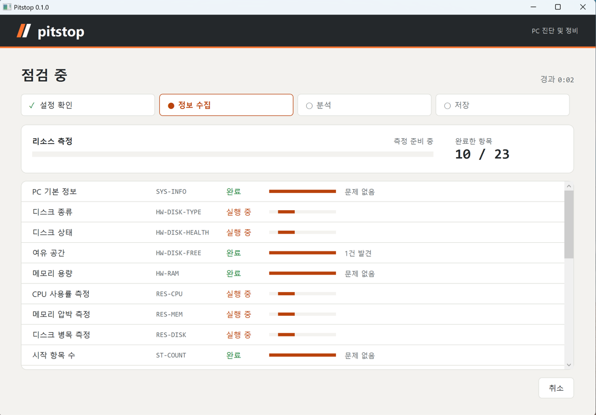
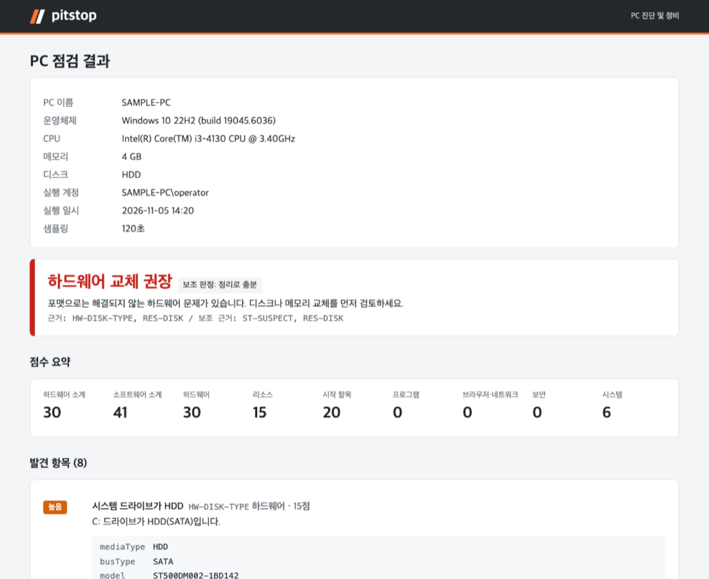

<a id="readme-top"></a>

<div align="center">
  

  <h1>PC Check</h1>

  <p>느려진 Windows PC를 포맷하기 전에, 정리로 충분한지부터 진단하는 도구</p>

  <p><b>한국어</b> | <a href="README.en.md">English</a></p>

  <p>
    <a href="https://github.com/Bigide19/pc-check/releases/latest/download/pccheck-win-x64.zip"></a>
    <a href="https://github.com/Bigide19/pc-check/releases/latest/download/PcCheck.exe"></a>
  </p>

  <p>
    
    
    
  </p>
</div>

<details>
<summary>목차</summary>

- [소개](#소개)
- [주요 기능](#주요-기능)
- [다운로드와 실행](#다운로드와-실행)
- [사용법](#사용법)
- [판정 기준](#판정-기준)
- [주의사항](#주의사항)
- [직접 빌드하기](#직접-빌드하기)
- [프로젝트 구조](#프로젝트-구조)

</details>

## 소개



PC가 느려지면 흔히 포맷부터 떠올립니다. 그런데 원인이 HDD나 메모리 부족이라면 포맷해도 금방 다시 느려지고, 시작 프로그램 몇 개가 원인이라면 포맷까지 할 필요가 없습니다. PC Check는 하드웨어, 리소스 사용량, 시작 항목, 브라우저 변조, 보안 상태를 한 번에 살펴보고 판정을 내립니다. 판정 결과는 "정리로 충분", "포맷 권장", "하드웨어 교체 권장" 중 하나입니다.

설치하지 않고 실행하는 단일 exe라서, USB나 원격 전송으로 옮겨 바로 실행할 수 있습니다. 진단은 읽기 전용이고, 시스템을 바꾸는 조치는 항목별로 승인을 받은 뒤에만 실행합니다.

<p align="right">(<a href="#readme-top">맨 위로</a>)</p>

## 주요 기능

- **진단 26개 항목**: 디스크 종류와 상태, 여유 공간, 메모리 용량, CPU와 메모리와 디스크의 부하(기본 120초 측정), 그래픽 드라이버, 시작 항목, 서비스, 예약 작업, 알려진 불필요 프로그램, 사진 앱, 앱을 종료시키는 프로그램, 은행, 공공기관 보안 모듈, 브라우저 정책과 확장, hosts, 프록시, 백신 상태, 위협 이력, 업데이트, 시스템 로그를 점검합니다.
- **원인 프로그램 찾기**: 앱이 반복해서 꺼지면 오류 기록에서 끼어든 모듈을 찾고, 그 모듈이 어느 프로그램 것인지 알려 줍니다. 제거 화면도 바로 띄울 수 있습니다.
- **보안 모듈 정리**: 은행, 공공기관 사이트용 보안 프로그램을 찾아 공개된 취약점과 함께 보여 주고, 한 번에 정리할 수 있게 합니다.
- **규칙 기반 판정**: 점수 합산이 아니라 우선순위 규칙으로 판정합니다. 포맷으로 해결되지 않는 하드웨어 문제를 가장 먼저 봅니다.
- **승인 기반 조치와 되돌리기**: 조치하기 전에 복원 지점을 만들고, 원래 값을 `actions.json`에 기록합니다. 삭제보다 비활성화를 우선하며, 되돌리기 화면에서 역순으로 원상 복구합니다.
- **리포트 파일**: 사람이 읽는 `report.html`(외부 리소스 없는 단일 파일)과 기계가 읽는 `findings.json`을 함께 저장하고, 결과 파일을 zip 하나로 묶어 둡니다.
- **Slack으로 받기**: 결과 화면에 Slack 웹훅 주소를 붙여 넣으면, 요약과 발견 항목을 메시지 여러 개로 나눠 보냅니다.
- **보호 목록**: `config/protect.json`에 등록한 업무 프로그램은 의심 판정과 조치 대상에서 뺍니다. 보안 모듈 목록은 `config/kr-modules.json`에서 고칠 수 있습니다.
- **오프라인 동작**: 악성코드 탐지는 Windows Defender에 맡기고, Slack으로 보내기를 누르지 않으면 네트워크를 쓰지 않습니다.



<p align="right">(<a href="#readme-top">맨 위로</a>)</p>

## 다운로드와 실행

1. [Releases](https://github.com/Bigide19/pc-check/releases/latest)에서 `pccheck-win-x64.zip`을 받아 압축을 풉니다. zip에는 `PcCheck.exe`와, 임계값과 보호 목록을 바꿀 수 있는 `config/` 폴더가 들어 있습니다. `PcCheck.exe`만 받아도 실행할 수 있고, 이때는 내장된 기본값을 사용합니다.
2. 받은 파일이 릴리스에 적힌 SHA-256과 같은지 확인합니다.

   ```powershell
   Get-FileHash .\PcCheck.exe -Algorithm SHA256
   ```

3. `PcCheck.exe`를 실행합니다. 관리자 권한이 필요해서 실행하면 UAC 창이 뜹니다.

코드 서명을 하지 않은 실행 파일이므로 처음 실행할 때 "Windows의 PC 보호" 경고가 뜹니다. **추가 정보**를 누른 뒤 **실행**을 누르면 됩니다. 백신이 시스템을 조회하는 도구로 오인해 차단하면, 점검하는 동안만 실행 폴더를 예외로 등록하고 점검이 끝나면 해제하세요.

<p align="right">(<a href="#readme-top">맨 위로</a>)</p>

## 사용법

### 화면에서 점검

1. 평소 사용하는 프로그램을 띄워 둔 상태에서 **점검 시작**을 누릅니다. 측정은 기본 120초이고, 빠른 측정은 30초입니다.
2. 결과 화면에서 판정, 근거 항목, 상위 프로세스를 확인합니다. **리포트 열기**를 누르면 `report.html`이 열립니다.
3. 정리가 필요하면 **조치 진행**을 누릅니다. 자동 항목을 실행한 뒤, 확인 항목을 하나씩 보여 주고 승인, 건너뛰기, 나머지 모두 건너뛰기 중에서 고르게 합니다.
4. 결과가 마음에 들지 않으면 시작 화면의 **이전 조치 되돌리기**로 원래대로 돌립니다.

결과는 exe와 같은 폴더의 `PcCheck_{yyyyMMdd_HHmm}\`에 저장됩니다. **결과 묶음(zip)** 버튼을 누르면 파일들을 zip 하나로 묶어 탐색기에서 보여 줍니다. 메신저나 USB로 옮길 때 이 파일 하나만 보내면 됩니다.

### Slack으로 결과 받기

1. Slack에서 받을 채널의 [수신 웹훅(Incoming Webhook)](https://api.slack.com/messaging/webhooks) 주소를 만듭니다.
2. 결과 화면 아래 칸에 그 주소(`https://hooks.slack.com/services/...`)를 붙여 넣고 **Slack으로 보내기**를 누릅니다.

판정과 점수를 담은 요약을 먼저 보내고, 발견 항목과 상위 프로세스, 수집 오류를 메시지 여러 개로 나눠 보냅니다. 입력한 주소는 저장하지 않습니다. 자주 쓰는 PC라면 환경 변수 `PCCHECK_SLACK_WEBHOOK`에 넣어 두면 칸이 미리 채워집니다. 웹훅 주소가 있으면 누구나 그 채널에 글을 쓸 수 있으니, 주소를 다른 사람에게 보여 주지 마세요.

### 창 없이 점검 (원격 실행용)

```powershell
.\PcCheck.exe scan                        # 기본 측정 (120초)
.\PcCheck.exe scan --quick                # 빠른 측정 (30초)
.\PcCheck.exe scan --defender-scan        # Defender 빠른 검사 포함
.\PcCheck.exe scan --defender-full-scan   # Defender 전체 검사 포함 (오래 걸림)
.\PcCheck.exe scan --slack                # 점검 후 PCCHECK_SLACK_WEBHOOK 주소로 결과 전송
```

창 없이 `findings.json`과 `report.html`만 만들고 종료합니다. 종료 코드 0은 결과 파일을 저장했다는 뜻이고, 3은 결과는 저장했지만 Slack 전송에 실패했다는 뜻입니다(이유는 결과 폴더의 `slack-error.txt`). 조치와 되돌리기는 승인이 필요해서 화면에서만 실행할 수 있습니다.

### 미리보기

```powershell
.\PcCheck.exe --mock
```

샘플 데이터로 결과, 조치, 되돌리기 화면을 끝까지 넘겨 볼 수 있습니다. 미리보기에서 실행하는 조치는 실제 PC를 바꾸지 않습니다.

<p align="right">(<a href="#readme-top">맨 위로</a>)</p>

## 판정 기준

위에서부터 순서대로 평가합니다. 임계값은 모두 `config/rules.json`에서 바꿀 수 있습니다.

| 판정 | 조건 (하나라도 해당하면) |
|---|---|
| 하드웨어 교체 권장 | 디스크 고장 예측, HDD이면서 디스크 병목, 메모리 4GB 이하이면서 메모리 압박 |
| 포맷 권장 | 제거되지 않은 위협, 의심 항목(시작 항목, 서비스, 예약 작업, 브라우저 정책과 확장, hosts, 프록시) High 5건 이상, 소프트웨어 점수 80점 이상 |
| 정리로 충분 | 소프트웨어 점수 10점 이상 |
| 이상 없음 | 그 외 |

하드웨어 교체 권장과 포맷 권장 조건에 함께 해당하면, 하드웨어 교체 권장을 주 판정으로, 포맷 권장을 보조 판정으로 함께 보여 줍니다. 자세한 항목별 기준은 [docs/spec.md](docs/spec.md)에 있습니다.

<p align="right">(<a href="#readme-top">맨 위로</a>)</p>

## 주의사항

- 판정은 참고용입니다. "포맷 권장"이 나와도 백업과 업무 프로그램 재설치가 가능한지 먼저 확인하세요.
- 조치하기 전에 중요한 자료를 백업하세요. 임시 파일 정리, 프로그램 제거, Defender 위협 제거는 툴로 되돌릴 수 없고, 복원 지점으로만 되돌릴 수 있습니다.
- 임시 파일 정리(1일 지난 파일 삭제)는 승인 없이 자동으로 실행되는 항목입니다.
- 리포트에는 사용자 이름이 들어간 경로가 그대로 남습니다. 다른 사람에게 보낼 때 주의하세요.
- 서명이 없는 정상 프로그램이 의심 항목으로 잡힐 수 있습니다. 업무 프로그램은 점검하기 전에 `config/protect.json`에 등록하세요.

<p align="right">(<a href="#readme-top">맨 위로</a>)</p>

## 직접 빌드하기

[.NET 10 SDK](https://dotnet.microsoft.com/download/dotnet/10.0)가 필요합니다. macOS에서도 빌드할 수 있지만, 실행은 Windows에서만 됩니다.

```bash
dotnet build PcCheck.slnx
dotnet test PcCheck.slnx
dotnet publish src/PcCheck.App -c Release -o publish   # publish/PcCheck.exe + publish/config/
```

<p align="right">(<a href="#readme-top">맨 위로</a>)</p>

## 프로젝트 구조

```
src/
  PcCheck.App/          WPF 화면, headless scan 진입점
  PcCheck.Core/         모델, 인터페이스, 설정 로드, Collector 실행기
  PcCheck.Collectors/   진단 항목별 Collector
  PcCheck.Analysis/     점수 계산, 판정 규칙
  PcCheck.Remediation/  조치, 복원 지점, 조치 기록, 되돌리기
  PcCheck.Report/       findings.json, report.html, Slack
config/                 rules.json, known-bad.json, protect.json, kr-modules.json
tests/                  단위 테스트
tools/vm/               Parallels VM 테스트 도구
docs/                   설계 명세, 작업 인계 문서
```

<p align="right">(<a href="#readme-top">맨 위로</a>)</p>
